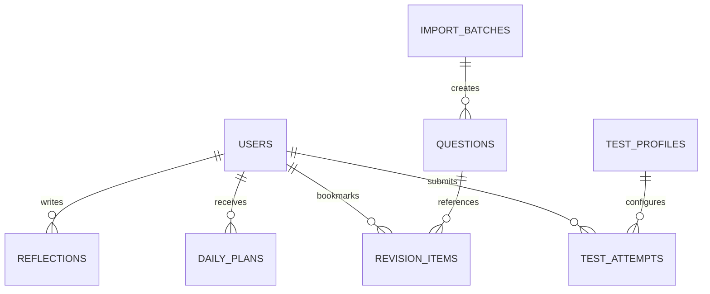

# SSB Mentor - Database Schema & Architecture

**Database System:** Cloud Firestore (Document Store)  
**Binary Storage:** Firebase Cloud Storage  
**Access Model:** Strict Principle of Least Privilege (Public/Draft Separation, Student Data Isolation, Role-Based Access Control)

---

## 1. Top-Level Collections Architecture



---

## 2. Collection Definitions

### `users` (Private user profile & role definition)
*Path:* `/users/{userId}`

| Field | Type | Description | Security |
|---|---|---|---|
| `id` | `string` | Firebase Auth UID (`request.auth.uid`) | User / Admin |
| `email` | `string` | User email address | User / Admin |
| `displayName` | `string` | Candidate full name | User / Admin |
| `role` | `string` | `"student"` \| `"admin"` (defaults to `"student"`) | **Immutable by client**; Admin only |
| `targetSSBDate` | `string` (ISO date) | Scheduled SSB Board appearance date | User / Admin |
| `targetEntry` | `string` | e.g. `"NDA"`, `"CDS"`, `"AFCAT"`, `"SSC-Tech"` | User / Admin |
| `preferredBoard` | `string` | e.g. `"1 AFSB Dehradun"`, `"33 SSB Bhopal"` | User / Admin |
| `dailyTimeTargetMinutes` | `number` | Default `90` minutes | User / Admin |
| `restDays` | `array<number>` | e.g. `[0]` for Sunday | User / Admin |
| `activePriorities` | `array<string>` | e.g. `["TAT", "Lecturette", "CIQ"]` | User / Admin |
| `createdAt` | `timestamp` | Profile creation timestamp | User / Admin |
| `updatedAt` | `timestamp` | Last update timestamp | User / Admin |

---

### `questions` (Global Question Bank items)
*Path:* `/questions/{questionId}`

| Field | Type | Description | Security |
|---|---|---|---|
| `id` | `string` | Deterministic ID (e.g. `wat_abc123`, `tat_def456`) | Read: Public (if published); Write: Admin |
| `category` | `string` | `"OIR"` \| `"PPDT"` \| `"TAT"` \| `"WAT"` \| `"SRT"` \| `"LECTURETTE"` \| `"GTO"` \| `"INTERVIEW"` \| `"CURRENT_AFFAIRS"` | Read: Public; Write: Admin |
| `subcategory` | `string` | e.g. `"VERBAL"`, `"NON_VERBAL"`, `"CIQ"`, `"GPE"` | Read: Public; Write: Admin |
| `title` | `string` | Item title or short prompt summary | Read: Public; Write: Admin |
| `content` | `string` \| `null` | Text question / word / scenario / situation | Read: Public; Write: Admin |
| `assetStoragePath` | `string` \| `null` | Cloud Storage path for picture or PDF (e.g. `questions/tat/tat_001.jpg`) | Read: Public; Write: Admin |
| `assetUrl` | `string` \| `null` | Download / CDN URL | Read: Public; Write: Admin |
| `metadata` | `map` | Category-specific attributes (e.g., options, answers, hints, lecturette cards) | Read: Public; Write: Admin |
| `sourceArchive` | `string` | Source ZIP filename | Admin only |
| `sourceFilename` | `string` | Original filename within archive | Admin only |
| `sourceReference` | `string` | Board, year, or booklet reference | Read: Public; Write: Admin |
| `tags` | `array<string>` | Searchable keywords (e.g. `["bhopal", "defense", "leadership"]`) | Read: Public; Write: Admin |
| `difficulty` | `string` | `"beginner"` \| `"intermediate"` \| `"advanced"` | Read: Public; Write: Admin |
| `verificationStatus` | `string` | `"unverified"` \| `"reviewed"` \| `"verified"` | Read: Public; Write: Admin |
| `publicationStatus` | `string` | `"draft"` \| `"published"` \| `"archived"` | Read: Public (only `published`); Write: Admin |
| `createdAt` | `timestamp` | Creation timestamp | Read: Public; Write: Admin |
| `updatedAt` | `timestamp` | Update timestamp | Read: Public; Write: Admin |

---

### `testProfiles` (Configurable test timing & rules)
*Path:* `/testProfiles/{profileId}`

| Field | Type | Description |
|---|---|---|
| `id` | `string` | e.g. `profile_wat_standard`, `profile_tat_standard` |
| `module` | `string` | `"TAT"`, `"WAT"`, `"SRT"`, `"PPDT"`, `"OIR"`, `"LECTURETTE"` |
| `title` | `string` | e.g. "WAT 60-Word Standard SSB Simulation" |
| `version` | `number` | Version counter (e.g. `1`, `2`) |
| `instructions` | `string` | Instructions presented before starting |
| `itemCount` | `number` | e.g. `60` words, `12` TAT pictures, `60` SRTs |
| `selectionMode` | `string` | `"ordered"` \| `"random"` \| `"set_based"` |
| `timings` | `map` | Viewing, response, preparation, speaking durations in seconds |
| `allowedNavigation` | `boolean` | Whether student can go back to previous items |
| `autoProgress` | `boolean` | Whether system advances automatically when timer expires |
| `autosaveIntervalSeconds`| `number` | Client response autosave frequency (default: 5s) |
| `isPracticeProfile` | `boolean` | Flag clarifying practice coaching format vs official SSB format |
| `isActive` | `boolean` | Active flag for student selection |
| `updatedAt` | `timestamp` | Last updated timestamp |

---

### `testAttempts` (Student test sessions and responses)
*Path:* `/testAttempts/{attemptId}`

| Field | Type | Description | Security |
|---|---|---|---|
| `id` | `string` | Unique attempt ID | Owner / Admin |
| `userId` | `string` | Owner UID | Owner / Admin |
| `module` | `string` | `"TAT"` \| `"PPDT"` \| `"WAT"` \| `"SRT"` \| `"LECTURETTE"` \| `"OIR"` | Owner / Admin |
| `profileId` | `string` | Reference to test profile used | Owner / Admin |
| `profileVersion` | `number` | Version snapshot at time of test | Owner / Admin |
| `status` | `string` | `"in_progress"` \| `"completed"` \| `"abandoned"` | Owner / Admin |
| `startedAt` | `timestamp` | Session start timestamp | Owner / Admin |
| `completedAt` | `timestamp` \| `null`| Session completion timestamp | Owner / Admin |
| `durationSeconds` | `number` | Actual duration spent | Owner / Admin |
| `totalItems` | `number` | Number of test items | Owner / Admin |
| `completedCount` | `number` | Items answered | Owner / Admin |
| `skippedCount` | `number` | Items skipped or timed out | Owner / Admin |
| `responses` | `array<map>` | Item responses: `[{ questionId, responseText, timeTakenMs, skipped, notes }]` | Owner / Admin |
| `selfReflection` | `map` \| `null` | Post-test reflection (e.g. perceived OLQs, confidence, areas to improve) | Owner / Admin |
| `audioRecordingUrl`| `string` \| `null` | Optional audio storage path for Lecturette / PPDT narration | Owner / Admin |

---

### `dailyPlans` (Personalized daily schedules)
*Path:* `/dailyPlans/{userId}_{YYYY-MM-DD}`

| Field | Type | Description |
|---|---|---|
| `id` | `string` | e.g. `uid123_2026-10-24` |
| `userId` | `string` | Student UID |
| `date` | `string` | `YYYY-MM-DD` |
| `targetMinutes` | `number` | e.g. `90` |
| `tasks` | `array<map>` | `[{ taskId, module, title, durationMinutes, isCompleted, completedAt, attemptId }]` |
| `status` | `string` | `"planned"` \| `"in_progress"` \| `"completed"` \| `"missed"` |
| `rolloverFromDate` | `string` \| `null` | Date of rescheduled incomplete tasks |
| `createdAt` | `timestamp` | Plan generation timestamp |
| `updatedAt` | `timestamp` | Last update |

---

### `reflections` (Journal entries and self-awareness)
*Path:* `/reflections/{reflectionId}`

| Field | Type | Description |
|---|---|---|
| `id` | `string` | Unique reflection ID |
| `userId` | `string` | Student UID |
| `title` | `string` | Entry title |
| `category` | `string` | `"SDT"` (Self Description) \| `"DAILY_JOURNAL"` \| `"INTERVIEW_EXPERIENCE"` \| `"GTO_INSIGHT"` |
| `content` | `string` | Markdown or plain text reflection |
| `tags` | `array<string>` | e.g. `["parents_opinion", "leadership", "confidence"]` |
| `createdAt` | `timestamp` | Timestamp |
| `updatedAt` | `timestamp` | Timestamp |

---

### `revisionItems` (Bookmarks & weak area tracking)
*Path:* `/revisionItems/{revisionId}`

| Field | Type | Description |
|---|---|---|
| `id` | `string` | Unique ID |
| `userId` | `string` | Student UID |
| `questionId` | `string` | Reference to question |
| `module` | `string` | `"WAT"`, `"SRT"`, `"LECTURETTE"`, etc. |
| `notes` | `string` | Candidate personal notes or alternate ideas |
| `reviewIntervalDays` | `number` | Spaced repetition interval (1, 3, 7, 14, 30 days) |
| `nextReviewDate` | `string` | `YYYY-MM-DD` |
| `isResolved` | `boolean` | Marked resolved by candidate |

---

### `importBatches` (Audit logging for admin imports)
*Path:* `/importBatches/{batchId}`

| Field | Type | Description |
|---|---|---|
| `id` | `string` | Batch identifier |
| `importedBy` | `string` | Admin UID |
| `sourceArchive` | `string` | ZIP filename |
| `category` | `string` | SSB category |
| `totalFiles` | `number` | Count of source files |
| `createdCount` | `number` | New items inserted |
| `skippedCount` | `number` | Duplicates skipped |
| `failedCount` | `number` | Errors encountered |
| `errors` | `array<map>` | Error log details |
| `importedAt` | `timestamp` | Execution timestamp |

---

## 3. Storage Hierarchy

```
gs://<bucket-name>/
├── questions/
│   ├── tat/
│   │   ├── tat_001.webp
│   │   └── ...
│   ├── ppdt/
│   │   ├── ppdt_001.webp
│   │   └── ...
│   ├── gto/
│   │   └── scenarios/
│   └── documents/
│       ├── oir/
│       └── reference/
└── users/
    └── {userId}/
        ├── recordings/
        │   ├── lecturette_{attemptId}.webm
        │   └── ppdt_narration_{attemptId}.webm
        └── exports/
```

---

## 4. Query & Indexing Patterns

1. **Question Selection by Module & Publication:**
   `collection("questions").where("category", "==", module).where("publicationStatus", "==", "published")`
   *Index:* `category ASC, publicationStatus ASC, createdAt DESC`

2. **Student Attempt History:**
   `collection("testAttempts").where("userId", "==", uid).where("module", "==", module).orderBy("startedAt", "desc")`
   *Index:* `userId ASC, module ASC, startedAt DESC`

3. **Student Daily Plan Lookup:**
   `doc("dailyPlans", uid + "_" + todayDate)`
   *Direct key lookup, 0 composite indexes needed.*

4. **Student Revision Queue:**
   `collection("revisionItems").where("userId", "==", uid).where("isResolved", "==", false).where("nextReviewDate", "<=", todayDate)`
   *Index:* `userId ASC, isResolved ASC, nextReviewDate ASC`
