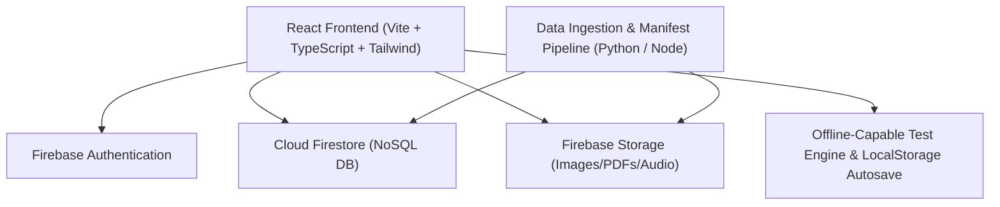

# SSB Mentor - System Architecture & Implementation Plan

**Project:** SSB Mentor — Complete SSB Preparation Platform  
**Architecture:** Single Page Application (React 19 + TypeScript + Vite + Tailwind CSS) with Firebase Backend (Auth, Cloud Firestore, Storage, Security Rules)  
**Primary Users:** SSB Aspirants (NDA, CDS, AFCAT, TGC, SSC-Tech, INET, CAPF) and Platform Administrators.

---

## 1. System Architecture Overview



---

## 2. Directory Structure

```
SSBMentor/
├── data/
│   ├── source-zips/          # Immutable original ZIP files
│   ├── staging/              # Extracted assets segregated by category
│   │   ├── OIR/
│   │   ├── PPDT/
│   │   ├── TAT/
│   │   ├── WAT/
│   │   ├── SRT/
│   │   ├── GTO/
│   │   ├── LECTURETTE/
│   │   └── INTERVIEW/
│   ├── manifests/            # Generated JSON question manifests
│   └── import-reports/       # Audit logs & ingestion reports
├── docs/
│   ├── DATA_AUDIT.md
│   ├── IMPLEMENTATION_PLAN.md
│   ├── DATABASE_SCHEMA.md
│   └── TEST_FORMATS.md
├── scripts/
│   └── import-data/          # Safe extraction, OCR/text extraction & Firestore importer
├── src/
│   ├── assets/
│   ├── components/
│   │   ├── common/           # Button, Modal, Card, Badge, Alert, Spinner, Timer
│   │   ├── layout/           # Navbar, Sidebar, Footer, MobileNav
│   │   ├── tests/            # TestRunner, TATViewer, WATViewer, SRTViewer, AudioRecorder
│   │   ├── dashboard/        # DailyTargetCard, ModuleProgress, WeeklyHeatmap, Calendar
│   │   └── admin/            # BatchImporter, QuestionEditor, ProfileEditor, AuditLog
│   ├── context/              # AuthContext, NotificationContext
│   ├── hooks/                # useAuth, useTestRunner, useAutosave, useAudioRecorder
│   ├── pages/
│   │   ├── auth/             # Login, Register, ForgotPassword
│   │   ├── dashboard/        # Student Dashboard
│   │   ├── tests/            # Psychology tests index & test runners
│   │   ├── lecturette/       # Lecturette studio
│   │   ├── gto/              # GPE scenarios & solutions
│   │   ├── interview/        # CIQ practice & mock interview
│   │   ├── journal/          # Self-Description (SDT) & reflection journal
│   │   ├── progress/         # Analytics & weak-area revision
│   │   └── admin/            # Admin dashboard, Question Bank manager, Import preview
│   ├── services/             # firebase.ts, questionService.ts, testAttemptService.ts, etc.
│   ├── types/                # TypeScript definitions for all domain models
│   ├── utils/                # timing.ts, formatters.ts, validation.ts
│   ├── App.tsx
│   └── main.tsx
├── firestore.rules           # Secure Firestore rules
├── storage.rules             # Secure Storage rules
├── package.json
├── tsconfig.json
├── vite.config.ts
├── tailwind.config.js
└── README.md
```

---

## 3. Detailed 12-Phase Roadmap

### Phase 1: Workspace & Data Inspection (Completed)
- Inventoried 8 source zip archives (559.97 MB).
- Relocated zips from root to `data/source-zips/`.
- Performed safe extraction into `data/staging/` across 8 categories (139 files total).
- Generated initial audit report, identified 14 duplicate files, flagged 8 review items.

### Phase 2: System Architecture & Schemas (In Progress)
- Generated `docs/DATA_AUDIT.md`, `docs/DATABASE_SCHEMA.md`, `docs/TEST_FORMATS.md`, `docs/IMPLEMENTATION_PLAN.md`.
- Defined role-based security rules and student isolation policy.

### Phase 3: Application Foundation & Authentication
- Initialize Vite React TypeScript Tailwind app.
- Setup core component system, routing, layout shell, mobile-first navigation.
- Implement Firebase Auth (Login, Register, Logout, Password Reset, AuthContext).
- Build mock/offline fallback mode when Firebase credentials are not yet configured.
- Establish role authorization guard (`student` vs `admin`).

### Phase 4: Data Processing & Ingestion Pipeline
- Python extraction pipeline to parse WAT lists, SRT text items, Lecturette topic cards, and Interview questions into structured JSON.
- Implement picture prompt extractor for PPDT and TAT into optimized WebP/JPG formats.
- Admin batch preview UI for visual review before committing imports.

### Phase 5: Sample Data Import & Verification
- Import curated sets of WAT, TAT, SRT, PPDT, and Lecturette questions.
- Verify deterministic IDs, deduplication, and asset loading.

### Phase 6: Core Test Engine & Psychology Modules
- Reusable test engine with customizable timers, distraction-free screen, auto-advance, and autosave.
- TAT module: 12-slide timed sequence, picture display, guided story input.
- WAT module: 60-word sequential presentation, 15-second response timer, instant review screen.
- SRT module: 60-situation timed booklet, response palette, completion metrics.
- PPDT module: Picture observation, character box notes, story writing, narration recorder, group discussion reflection.

### Phase 7: Lecturette, GTO, Interview & Current Affairs
- Lecturette studio: Topic selection card, 3-minute prep, 3-minute speech timer, optional mic recording, self-assessment rubric.
- GTO / GPE exercise: Map & scenario narrative viewer, problem priority planner, resource allocation tool, model solution breakdown.
- Interview & CIQ builder: Step-by-step CIQ questionnaire, personal answer journal, technical questions module.
- Current Affairs & Defense knowledge reader with revision bookmarking.

### Phase 8: Student Dashboard, Daily Planner & Analytics
- 90-minute daily schedule generator with module rotation (configurable target).
- Intelligent backlog rescheduling (no demotivating backlog pile-up).
- Self-Description Test (SDT) builder (5 paragraphs: Parents, Teachers, Friends, Self, Improvements).
- Spaced-repetition revision queue and consistency tracking.

### Phase 9: Admin Management Suite
- Question bank search, filter, inline edit, create, publish, and archive.
- Test profile configuration editor (adjust timings, item counts, navigation rules).
- Bulk CSV/JSON import and dry-run preview.
- Audit logs for administrative actions.

### Phase 10: Automated Testing & Verification
- Unit & integration tests for test timers, autosave, authentication guards, and data validation.
- End-to-end user journeys (Student test completion, Admin import preview, Student privacy boundary).

### Phase 11: Production Hardening & Documentation
- Finalize `firestore.rules` and `storage.rules`.
- Create `.env.example`, admin bootstrap script, Firebase project configuration guide.
- Complete comprehensive `README.md`.

### Phase 12: Deployment Readiness
- Production build validation (`npm run build`).
- Verify asset paths, bundle size, and performance.
- Document deployment steps (Firebase Hosting, Vercel, or Netlify).
