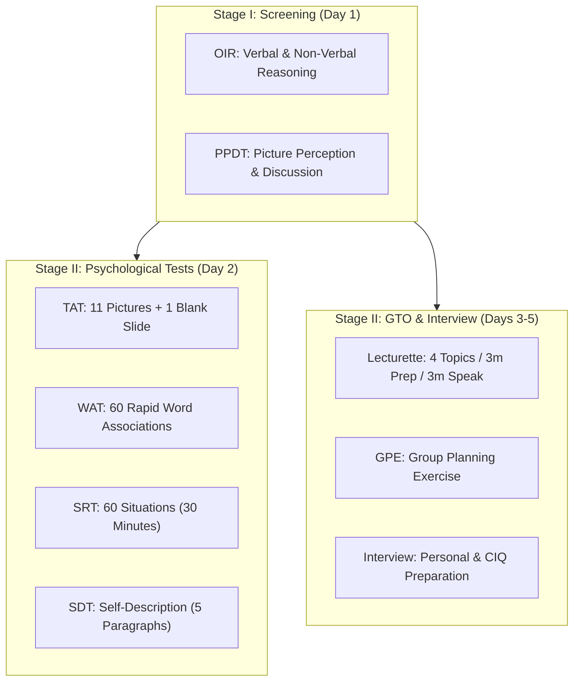

# SSB Mentor - Configurable Test Formats & Specifications

**Purpose:** This document details the standard and practice configurations for all SSB preparation modules in SSB Mentor.  
**Disclaimer:** All timings represent standard coaching practice and historical SSB board formats. The platform explicitly labels practice profiles separately from official SSB board procedures to maintain accuracy.

---

## 1. Test Profiles Overview

---

## 2. Module Specifications

### 2.1 Thematic Apperception Test (TAT)

- **Default Item Count:** 12 slides (11 picture slides + 1 final blank slide).
- **Viewing Phase:** 30 seconds per slide. Story writing area is visible or locked to encourage focused picture observation.
- **Story Writing Phase:** 4 minutes (240 seconds) per slide.
  - Guided structure prompt: *Past (What led to the situation) $\to$ Present (What is happening right now, thoughts & actions of the hero) $\to$ Future (Outcome).*
- **Blank Slide (Slide 12):** 30 seconds blank white display $\to$ 4 minutes to write a story about a pre-conceived or positive personal theme.
- **Progression:** Automatic progression after 4 minutes 30 seconds per slide.
- **Navigation:** Sequential forward-only during active simulation. Candidates cannot navigate back to edit previous pictures (matches SSB board condition).
- **Autosave:** Saves candidate text every 5 seconds to local draft storage and synchronizes to `testAttempts`.
- **Post-Test Reflection:** Only displayed after the entire test is submitted:
  - Hero identification
  - Identified Officer Like Qualities (OLQs) reflected in the story
  - Personal review notes

---

### 2.2 Picture Perception and Description Test (PPDT)

- **Phases:**
  1. **Phase 1: Observation (30 seconds):** Candidate views a hazy/clear picture.
  2. **Phase 2: Character Box & Action (1 minute):** Candidate records:
     - Number of characters
     - Main character age, sex (M/F/P), and mood (+ / - / 0)
     - Theme / Action title
  3. **Phase 3: Story Writing (4 minutes):** Candidate types story within 4 minutes.
  4. **Phase 4: Narration Practice (1 minute):** Optional audio recording with explicit microphone permission. 1-minute countdown timer with waveform/audio level monitor.
  5. **Phase 5: Group Discussion Reflection:** Guided prompts to evaluate participation, active listening, composure, and consensus building.
- **Autosave:** Active during character box and story phase.

---

### 2.3 Word Association Test (WAT)

- **Default Item Count:** 60 words.
- **Word Exposure & Response Duration:** 15 seconds per word.
- **Progression:** Automatic progression immediately when timer reaches 0.
- **Distraction-Free Mode:** High-contrast, large-font word display centered on screen.
- **Hints & Prompts:** Strict restriction — no hints, sample sentences, or OLQ tags visible during active test.
- **Timeout & Skip Handling:** If no keystroke within 15 seconds, records `skipped: true` and moves instantly to next word.
- **Post-Test Review:** Complete review screen displaying:
  - Candidate sentence
  - Response latency (ms taken)
  - Skipped words highlighted
  - Spaced repetition bookmarking for revision

---

### 2.4 Situation Reaction Test (SRT)

- **Default Item Count:** 60 situations.
- **Total Duration:** 30 minutes (1,800 seconds) continuous overall timer.
- **Navigation:** Free navigation between situations with an item palette (Answered, Unanswered, Marked for Review).
- **Response Capture:** Direct input under each situation.
- **Autosave:** Instant autosave on blur and every 5 seconds.
- **Post-Test Review:**
  - Count of completed situations (e.g., 42/60)
  - Average time spent per situation
  - Self-reflection on practicality, speed, and safety considerations.

---

### 2.5 Lecturette

- **Topic Selection:**
  - Displays a card with 4 topics (High level, Medium level 1, Medium level 2, Low level).
  - Candidate can choose 1 topic manually within 10 seconds or system auto-selects.
- **Preparation Phase:** 3 minutes countdown timer. Note-taking area available for bullet points and structure.
- **Speaking Phase:** 3 minutes countdown timer.
  - Optional audio recording with microphone permission.
  - Warning chime at 2 minutes 30 seconds (30 seconds remaining alert).
- **Post-Session Self-Review:**
  - Rubric: Introduction & Definition (1-5), Core Analysis & Examples (1-5), Body Language & Fluency (1-5), Conclusion & Way Forward (1-5).
  - Playback of recorded audio for self-evaluation.

---

### 2.6 Officer Intelligence Rating (OIR)

- **Test Profiles:**
  - Standard Verbal Test (40-50 questions, 25-30 minutes)
  - Standard Non-Verbal Test (40-50 questions, 25-30 minutes)
- **Question Types:**
  - Analogies, odd one out, series completion, coding-decoding, blood relations, direction sense, figure matrix, paper folding, cube rotation.
- **Scoring:** Automatic computation of OIR Grade (Rating 1 to 5) based on percentage of correct responses.

---

### 2.7 Group Planning Exercise (GPE / GTO)

- **Scenario Model:**
  - Narrative with map/layout displaying terrain, road, railway, telephone booth, hospital, police post.
  - Multiple problems (Priority 1: Life threatening, Priority 2: Serious damage/crime, Priority 3: Minor issue/target time).
  - Available resources (Group members, vehicle, boat, ropes, time constraints).
- **Workflow:**
  1. Reading & Understanding (5 minutes)
  2. Individual Solution Writing (10 minutes)
     - Problem Priority Matrix
     - Group division & resource allocation
     - Time & distance calculation
     - Rejoining plan
  3. Discussion Reflection & Comparison with Model Strategy.

---

### 2.8 Personal Interview & CIQ Preparation

- **Categorized Question Bank:**
  - CIQ 1: Education, Academic performance, Teachers, Favorite subjects
  - CIQ 2: Family background, Relationships, Financial status, Daily routine
  - CIQ 3: Friends, Activities, Social circles, Hobbies & Interests
  - Technical & Armed Forces: Why Armed Forces, Branch preferences, Current defense acquisitions, Technical stream questions.
- **Mock Interview Runner:**
  - Step-by-step interview session
  - Audio recording or text notes
  - Genuine experience logging (prevents AI fabrication of student personal life).
